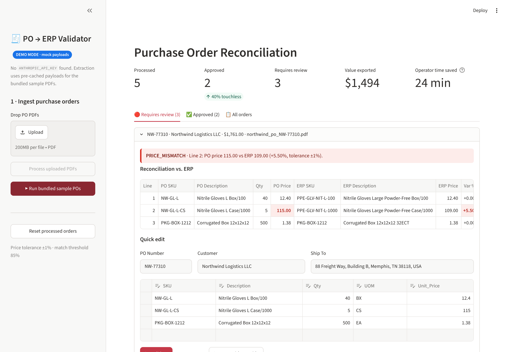

# AI PO → ERP Validator

An Intelligent Document Processing (IDP) pipeline for B2B purchase orders. It extracts unstructured PDF purchase orders with a multimodal LLM (Anthropic Claude, text or vision) into a strict Pydantic schema, reconciles every line item against a master ERP catalog using deterministic fuzzy matching (RapidFuzz), enforces price tolerances and business rules in plain Python, and routes the result to one of two outcomes: a clean, ERP-ready CSV import file, or a `REQUIRES_REVIEW` Human-in-the-Loop queue with each discrepancy flagged at line and field level.

The LLM reads the document. Python makes the decisions.



---

## Why This Architecture Matters

**The problem with naive LLM wrappers.** Sending a PDF to a chat model and pushing its JSON answer into an ERP fails in predictable ways:

- **Hallucinated or "corrected" SKUs.** The model maps "Hex Bolt M8x40" to whichever catalog item seems plausible. Zinc-plated and stainless steel cost twice as much apart, and nobody notices until the invoice dispute.
- **Unreliable math.** LLMs are not calculators. Totals, unit conversions and price comparisons done by the model drift by cents or by orders of magnitude.
- **Silent data corruption.** Free-text output parsed with regex breaks quietly when a vendor changes its template. A missing PO number becomes an empty string, and a duplicate order ships twice.
- **No audit trail.** Nothing records why a line was accepted, so there is nothing to defend in an audit.

**How this pipeline solves it.** Probabilistic extraction and deterministic validation are strictly separated:

| Stage | Responsibility | Nature |
|---|---|---|
| `extractor.py` | Transcribe what is printed on the page into a typed schema | Probabilistic (LLM), constrained by tool schema and Pydantic |
| `validator.py` | Match customers and SKUs, compare prices, apply business rules | Deterministic Python + SQLite + RapidFuzz |
| `pipeline.py` / `exporter.py` | Route, persist, export | Deterministic |

The model is never asked to choose an internal SKU, approve an order or compute a price variance. If extraction is uncertain or the data disagrees with the ERP, the order goes to a human with the exact reason attached. It never gets a silent best guess.

---

## Pipeline Architecture

```
 ┌───────────────────────┐
 │  Input PO (PDF)       │  digital PDF or scanned image, any vendor layout
 └───────────┬───────────┘
             │  extractor.read_pdf()  ── PyMuPDF
             │  text layer ≥ 80 chars → text      |  otherwise → page PNGs @150 DPI (max 5 pages)
             ▼
 ┌─────────────────────────────────────────────────────────────────────┐
 │  Multimodal Extraction (Strict Schema)        extractor.POExtractor │
 │  • Claude forced to call ONE tool: record_purchase_order            │
 │  • tool input_schema = PurchaseOrder.model_json_schema()            │
 │  • Pydantic re-validation, 1 self-repair retry with the error text  │
 │  • Demo mode: pre-cached payloads, no API key, no network           │
 └───────────┬─────────────────────────────────────────────────────────┘
             │  PurchaseOrder {PO_Number, Customer_Name, Ship_To, Line_Items[]}
             ▼
 ┌─────────────────────────────────────────────────────────────────────┐
 │  SKU Reconciliation vs. Master Catalog           validator.POValidator│
 │  1. exact internal SKU            → confidence 100                  │
 │  2. exact legacy customer SKU     → confidence 100                  │
 │  3. normalised SKU (A-Z0-9 only)  → confidence 98                   │
 │  4. RapidFuzz WRatio on normalised description (top-3 candidates)   │
 │     < 60 → ITEM_NOT_FOUND │ < 85 or top-2 within 4 pts → AMBIGUOUS  │
 └───────────┬─────────────────────────────────────────────────────────┘
             ▼
 ┌─────────────────────────────────────────────────────────────────────┐
 │  Business Rules & Price Tolerance Engine                            │
 │  • |PO price − ERP price| / ERP price > 1 %  → PRICE_MISMATCH       │
 │  • missing / already-exported PO number      → MISSING / DUPLICATE  │
 │  • customer fuzzy match + ship-to cross-check                       │
 │  • qty ≤ 0                                   → INVALID_QTY          │
 └───────────┬─────────────────────────────────────────────────────────┘
             │  ValidationResult {status, lines[], flags[]}
             ▼
     ┌───────┴────────────────────────────┐
     │ flags == []                        │ flags != []
     ▼                                    ▼
 ┌──────────────────────┐      ┌───────────────────────────────────────┐
 │ APPROVED             │      │ REQUIRES_REVIEW                       │
 │ exporter.export_csv()│      │ Streamlit console (app.py):           │
 │ → erp_import/PO_*.csv│◄─────│ flagged cells in red, inline edit,    │
 └──────────────────────┘      │ Re-validate or Approve with override  │
                               └───────────────────────────────────────┘
        every result persisted to SQLite `processed_orders` (full JSON + flags)
```

---

## Engineering Highlights & Guardrails

**Extraction (`extractor.py`, `models.py`)**
- **Schema-constrained output.** Claude is called with `tool_choice={"type": "tool", "name": "record_purchase_order"}` and the tool's `input_schema` is generated from the `PurchaseOrder` Pydantic model. There is no free-text parsing and no regex.
- **Double validation with self-repair.** The tool payload is validated again by Pydantic (`extra="forbid"`, `min_length=1` on `Line_Items`, numeric types). On a `ValidationError`, the error is returned to the model as an `is_error` tool result for exactly one corrective retry. If that also fails, `ExtractionError` is raised, so a malformed order never continues down the pipeline.
- **Anti-hallucination system prompt.** The model transcribes only what is printed: `PO_Number` is `null` when absent (never inferred from invoice or quote numbers), buyer and vendor are kept distinct, and subtotal, tax and freight rows are excluded.
- **Text-first, vision fallback.** `read_pdf()` sends the PyMuPDF text layer when it exists, which is cheaper and exact. Scans and faxes are rasterised and sent as images. A `MAX_PAGES = 5` limit caps cost.
- **Normalisation at the boundary.** Blank SKU and UOM strings become `None`, and PO numbers are trimmed, so downstream rules see consistent types.
- **Configurable model.** `ANTHROPIC_MODEL` (default `claude-sonnet-5-5`) is read from the environment and is not hard-coded.

**Reconciliation (`validator.py`)**
- **Deterministic match cascade:** internal SKU, then legacy customer SKU (`legacy_customer_sku` column), then normalised SKU (`FAS m8 40 zn` → `FASM840ZN`), then fuzzy description. Every line records `match_method` and `confidence`.
- **RapidFuzz scoring.** `process.extract(..., scorer=fuzz.WRatio, limit=3)` runs on descriptions pre-normalised by `_norm_text()`, which collapses `40 mm` → `40mm` and `M8x40` → `m8 x 40` so formatting noise does not decide the score.
- **Ambiguity is a first-class outcome.** A best match below 85 % is flagged, and so is a best match above 85 % whose runner-up is within `AMBIGUITY_MARGIN` (4 points). In the sample data, zinc and stainless M8 bolts score 90/90 and are routed to a human with both candidates shown, instead of being auto-picked.
- **Customer resolution** uses the same fuzzy logic (`CUSTOMER_AMBIGUOUS` when two accounts tie) plus a `token_set_ratio` ship-to cross-check against the ERP address on file (threshold 80).

**Business rules and numeric integrity**
- **Price tolerance:** `variance = (po_price − erp_price) / erp_price` is computed in Python and flagged when `abs(variance) > PRICE_TOLERANCE` (default 0.01). The signed percentage is stored per line (`price_variance_pct`).
- **No LLM arithmetic downstream.** Order totals and CSV `line_total` values are computed in Python from validated `qty × unit_price`. The model's numbers are inputs, never results.
- **Duplicate protection:** a PO number already exported as `APPROVED` raises `DUPLICATE_PO`, which prevents double shipment.
- **Single routing rule:** any flag means `REQUIRES_REVIEW`. There are no silent warnings.

**Outputs, persistence and Human-in-the-Loop**
- **Typed results.** `ValidationResult` holds the status, matched lines (ERP SKU, ERP price, variance, top-3 candidates) and `Flag` objects (`code`, `message`, `line_no`, `field`) that the UI uses to highlight exact cells.
- **ERP import CSV** (`exporter.export_csv`): one file per approved PO in `erp_import/`, with a fixed column contract that includes `match_method` and `match_confidence` for traceability. Export of a non-approved order raises `ValueError` unless an explicit operator override is passed.
- **Audit trail.** Every run is stored in the SQLite `processed_orders` table with its full result JSON, extraction mode (`live`/`demo`), CSV path and `reviewed_by`. Operator overrides keep their original flags.
- **Review loop.** In `app.py`, the operator edits header fields or line items, then **Re-validate** (`Pipeline.revalidate`) runs the same rules again. **Approve with override** is explicit and recorded.
- **Configuration over code:** `PRICE_TOLERANCE`, `MATCH_CONFIDENCE_THRESHOLD`, `AMBIGUITY_MARGIN`, `ERP_DB_PATH` and `ERP_IMPORT_DIR` are environment variables (`.env.example`).
- **Tested.** 13 pytest cases cover every sample scenario end to end, tolerance boundaries (+0.72 % passes, +1.45 % flags), SKU normalisation, duplicate detection, the edit-and-revalidate loop, and the live extraction path (prompt building, tool parsing, repair retry) against a stubbed client.

---

## Repository Structure

```
AI-PO-ERP/
├── app.py                    # Streamlit operator console: KPIs, red-flag review queue, inline edit, CSV download
├── pipeline.py               # Orchestrator (extract → validate → persist → export) + batch CLI
├── extractor.py              # PyMuPDF reader + Claude schema-forced extraction + Demo/Mock mode
├── validator.py              # Deterministic reconciliation: SKU cascade, RapidFuzz, price & business rules
├── exporter.py               # Writes ERP import CSVs for APPROVED orders
├── models.py                 # Pydantic contracts: PurchaseOrder, LineItem, Flag, MatchedLine, ValidationResult
├── database.py               # SQLite mock ERP (customers, catalog_items) + processed_orders store
├── config.py                 # Environment-driven settings (model, thresholds, paths)
├── scripts/
│   └── generate_samples.py   # Builds the synthetic PO PDFs (incl. a rasterised scan) + matching mock payloads
├── samples/
│   ├── pdfs/                 # 5 synthetic purchase orders covering each routing scenario
│   └── mock_payloads/        # Pre-cached extraction JSON used in Demo mode
├── tests/
│   ├── conftest.py           # Isolated temp ERP database per test
│   └── test_pipeline.py      # End-to-end, rules, tolerance and stubbed-LLM tests
├── erp_import/               # Generated ERP import CSVs
├── data/                     # SQLite database (created at runtime)
├── review_queue.png          # Screenshot used above
├── requirements.txt
└── .env.example              # API key, model ID, tolerances, paths
```

---

## Quick Start (Run the Demo in 60 Seconds)

No API key is needed. Without `ANTHROPIC_API_KEY`, the extractor runs in Demo mode and serves pre-cached extraction payloads for the bundled sample POs. Everything downstream (matching, rules, routing, export) runs exactly as it would in production.

```bash
git clone https://github.com/Dieginho1208/AI-PO-ERP.git
cd AI-PO-ERP
python -m venv .venv && source .venv/bin/activate      # Windows: .venv\Scripts\activate
pip install -r requirements.txt

python database.py --reset      # seed the mock ERP (6 customers, 16 catalog items)
python pipeline.py              # batch-process samples/pdfs in the terminal
streamlit run app.py            # operator console at http://localhost:8501
pytest -q                       # 13 tests
```

**Live extraction on your own PDFs:**

```bash
cp .env.example .env
# ANTHROPIC_API_KEY=sk-ant-...
# ANTHROPIC_MODEL=claude-sonnet-5-5
python pipeline.py path/to/purchase_orders/
python extractor.py path/to/po.pdf          # print the validated extraction JSON only
```

---

## Sample Execution Output

`python pipeline.py` on the bundled synthetic POs:

```
Mode: DEMO  (model: mock payloads)

acme_po_45821.pdf                  PO=45821        APPROVED         flags=0 total=$902.50
    → erp_import/PO_45821_20261115_145516.csv
acme_services_po_8812.pdf          PO=AIS-8812     REQUIRES_REVIEW  flags=2 total=$435.00
    ⚠ CUSTOMER_AMBIGUOUS: 'ACME Industrial' matches both 'Acme Industrial Supply Co.' (90%) and 'Acme Industrial Services Ltd.' (90%).
    ⚠ SHIP_TO_MISMATCH: Ship-to differs from ERP address on file '1200 Harbor Blvd, Dock 4, Long Beach, CA 90813, USA' (37% similar).
globex_scan_po.pdf                 PO=—            REQUIRES_REVIEW  flags=2 total=$958.60
    ⚠ MISSING_PO_NUMBER: PO number is missing on the document.
    ⚠ ITEM_AMBIGUOUS: Line 1: 'Hex Bolt M8x40' is ambiguous between 'Hex Bolt M8 x 40mm Zinc Plated' (90%) and 'Hex Bolt M8 x 40mm Stainless Steel A2' (90%).
initech_po_IN-2026-0917.pdf        PO=IN-2026-0917 APPROVED         flags=0 total=$591.90
    → erp_import/PO_IN-2026-0917_20261115_145516.csv
northwind_po_NW-77310.pdf          PO=NW-77310     REQUIRES_REVIEW  flags=1 total=$1,761.00
    ⚠ PRICE_MISMATCH: Line 2: PO price 115.00 vs ERP 109.00 (+5.50%, tolerance ±1%).
```

**Auto-approved:** the ERP import file written for PO 45821 (`erp_import/PO_45821_*.csv`):

```csv
po_number,customer_id,customer_name,ship_to,line_no,internal_sku,description,uom,qty,unit_price,line_total,match_method,match_confidence
45821,C-1001,Acme Industrial Supply Co.,"1200 Harbor Blvd, Dock 4, Long Beach, CA 90813, USA",1,FAS-M8-40-ZN,Hex Bolt M8 x 40mm Zinc Plated,BX100,20.0,18.50,370.00,exact_sku,100.0
45821,C-1001,Acme Industrial Supply Co.,"1200 Harbor Blvd, Dock 4, Long Beach, CA 90813, USA",2,FAS-M8-NUT-ZN,Hex Nut M8 Zinc Plated,BX100,20.0,6.75,135.00,exact_sku,100.0
```

**Flagged:** the persisted result for PO NW-77310, line 2. The SKU resolved correctly through the legacy cross-reference, but the price failed the tolerance check:

```json
{
  "status": "REQUIRES_REVIEW",
  "flags": [
    {
      "code": "PRICE_MISMATCH",
      "message": "Line 2: PO price 115.00 vs ERP 109.00 (+5.50%, tolerance ±1%).",
      "line_no": 2,
      "field": "Unit_Price"
    }
  ],
  "line_2": {
    "internal_sku": "PPE-GLV-NIT-L-1000",
    "match_method": "legacy_sku",
    "confidence": 100.0,
    "erp_unit_price": 109.0,
    "price_variance_pct": 5.5
  }
}
```

### Flag reference

| Code | Trigger |
|---|---|
| `MISSING_PO_NUMBER` | No PO number on the document |
| `DUPLICATE_PO` | PO number already approved and exported |
| `CUSTOMER_NOT_FOUND` / `CUSTOMER_AMBIGUOUS` | Customer match < 85 %, or two accounts within 4 points |
| `SHIP_TO_MISMATCH` | Ship-to < 80 % similar to the ERP address on file |
| `ITEM_NOT_FOUND` / `ITEM_AMBIGUOUS` | No SKU hit and description match < 60 % / < 85 %, or a near-tie between catalog items |
| `PRICE_MISMATCH` | Unit price deviates from the ERP price list by more than 1 % |
| `INVALID_QTY` | Quantity ≤ 0 |

---

## Tech Stack

Python 3.10+ · Anthropic Claude (tool use, vision) · PyMuPDF · Pydantic v2 · RapidFuzz · SQLite · Streamlit · pandas · pytest

---

## Confidentiality / Portfolio Note

This is a sanitized portfolio edition of a purchase-order automation pattern drawn from real industrial distribution and ERP order-entry workflows. All customers, addresses, SKUs, prices and purchase orders in this repository are synthetic and generated by `scripts/generate_samples.py` and `database.py`. No client code, data or proprietary integration logic is included. Connectors to production ERPs (SAP, NetSuite, Dynamics 365, Odoo) and to inbound channels (email, SFTP, EDI portals) are replaced here by SQLite and CSV, behind the same interfaces.
